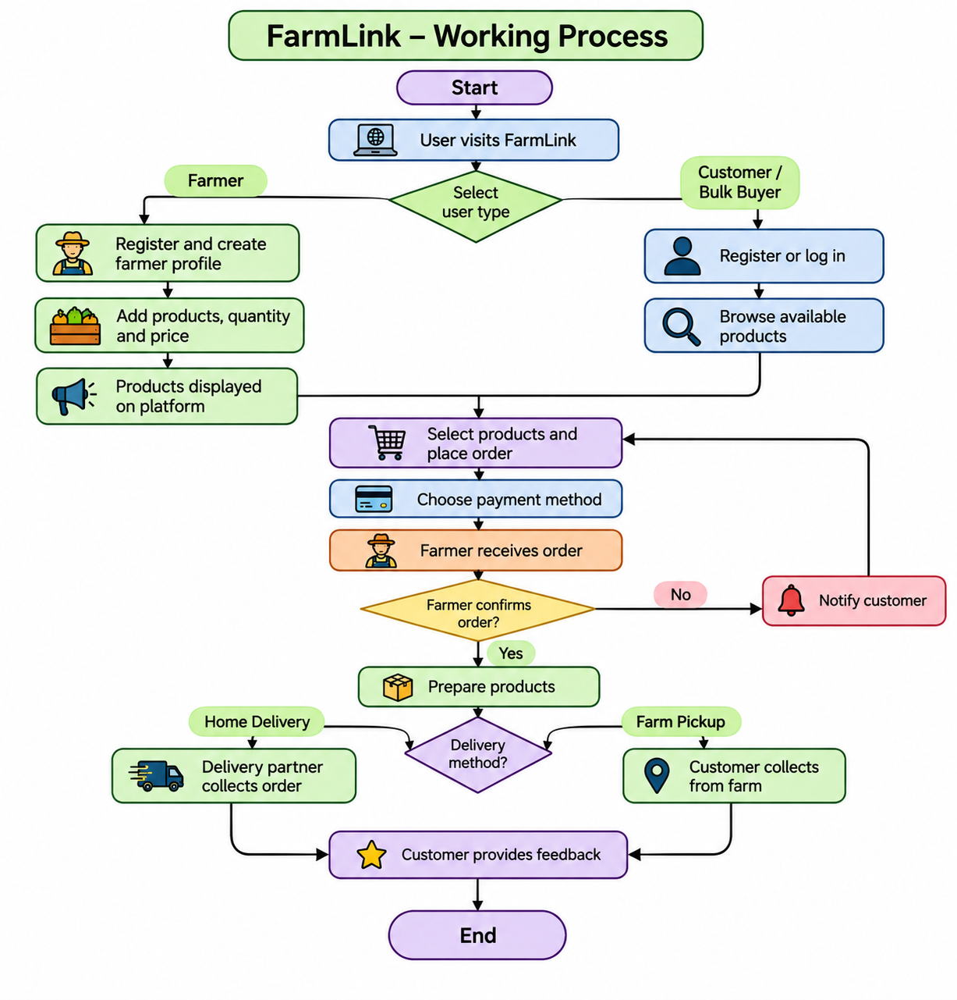

# Smart India Hackathon Workshop
# Date:24.11.2026
## Reference Number:26001079
## Name:Rivyudhaa M

## Problem Title
SIH 26033: Multiple intermediaries reduce farmers earnings and increase consumer prices.

## Problem Creater's Organization
Ministry of Consumer Affairs, Food & Public Distribution

## Theme
Agriculture, FoodTech & Rural Development

## Problem Description
Expected Solution: Create a digital marketplace that:

• Connects farmers/FPOs directly with consumers and bulk buyers.
• Provides logistics support.
• Uses AI for demand forecasting and route optimization.

Benefits:

• Better prices for farmers.
• Lower prices for consumers.
• Reduced supply chain inefficiencies.

## Proposed Solution

FarmLink is a web-based platform that connects farmers directly with individual consumers, supermarkets, restaurants and bulk buyers. Farmers can register, upload their products, mention available quantities and set their prices. The platform supports both individual and bulk orders at the same price for products of the same quality. It also provides delivery services,farm visits, flexible payment options and order tracking.

FarmLink combines direct agricultural trading, logistics support and AI-based demand prediction in one platform. It allows consumers to visit farms and collect their orders, creating greater transparency and trust. Regional language support makes the platform accessible to more people. Farmer profiles, ratings and reviews further encourage transparency and continuous improvement.

FarmLink combines direct agricultural trading, logistics support and AI-based demand prediction in one platform. It allows consumers to visit farms and collect their orders, creating greater transparency and trust. Regional language support makes the platform accessible to more people. Farmer profiles, ratings and reviews further encourage transparency and continuous improvement.

## Technical Approach

The frontend of FarmLink will be developed using HTML, CSS and JavaScript to create a simple and user-friendly interface. Python with the Django framework will be used for backend development and handling user accounts, products and orders.
SQLite will initially be used to store farmer details, product information and order records. OpenStreetMap can be explored for location-based services and delivery route planning.

## Feasibility and Viability

FarmLink is feasible as a web-based platform that connects farmers directly with individual customers and bulk buyers. It can be developed using HTML, CSS, JavaScript and Python Django, with SQLite for storing user, product and order details. The platform can initially focus on farmer registration, product listings and order management. Features such as demand prediction, delivery coordination and order tracking can be introduced as development progresses.

Coordinating deliveries between farmers, customers and delivery partners may be challenging. Farmers may also find it difficult to estimate the demand for their products, which could result in unsold surplus produce. Maintaining the freshness of agricultural products during delivery is another concern. In addition, making the platform accessible to farmers and customers who prefer regional languages may require careful design.

FarmLink will support both delivery through delivery partners and direct farm collection to provide flexible purchasing options. AI-based demand prediction can help farmers estimate future demand using previous sales data. Surplus produce can be connected with restaurants, hotels and other food businesses to reduce wastage, provided the produce is still suitable for sale. Regional language support and a simple interface will make the platform easier to use.

## Impact and Benefits

FarmLink helps farmers connect directly with individual customers and bulk buyers. It allows farmers to set their own prices and reach more customers, reducing their dependence on intermediaries. Consumers can purchase fresh agricultural products directly from farmers. Regional language support also makes the platform easier for farmers to access and use.

FarmLink can help farmers earn better returns while providing consumers with fair prices. It promotes transparency through farmer profiles, ratings and customer reviews. Connecting farmers with restaurants, hotels and other food businesses helps reduce the wastage of suitable surplus produce. Demand prediction can also help farmers make informed decisions about future cultivation.

## Research and References

1. [Government of India - Farmers' Income](https://www.pib.gov.in/)

2. [e-NAM - National Agriculture Market](https://enam.gov.in/web/)

3. [Food and Agriculture Organization (FAO) - Food Loss and Waste](https://www.fao.org/platform-food-loss-waste/flw-data/en)

